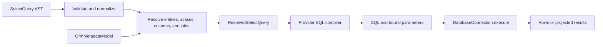

# TyORM

TyORM is a TypeScript ORM inspired by Java Persistence API (JPA). It combines decorator-based entity metadata with an explicit query API for building parameterized SQL. Use `DataSource` with the PostgreSQL or SQLite provider to query registered entities and write through repositories. Database-independent query semantics, relationship resolution, projections, and transaction orchestration live in Core.

## Supported databases

| Database | TyORM driver | Connector used by the driver |
| --- | --- | --- |
| PostgreSQL | [`@tyorm/postgres`](packages/drivers/postgres) `0.1.0` | `pg` `^8.16.3` in the package manifest, with `8.23.1` resolved by the workspace lockfile. |
| MySQL | [`@tyorm/mysql`](packages/drivers/mysql) `0.1.0` | `mysql2` `^3.0.0`, with `3.24.6` resolved by the workspace lockfile. |
| SQLite | [`@tyorm/mysql`](packages/drivers/mysql) | The MySQL provider, parameterized SELECT compilation, and pooled connections with transaction support. |
| [`@tyorm/sqlite`](packages/drivers/sqlite) `0.1.0` | Built-in `node:sqlite`. The package requires Node.js 22.16+ within the 22.x line, or Node.js 24+. |

The TyORM version identifies the adapter package. For PostgreSQL, `pg` has its own version. For SQLite, the SQLite engine version comes from the Node.js runtime and can be checked with `SELECT sqlite_version()`. The workspace validation on Node.js 26.13.0 used SQLite 3.54.0.

PostgreSQL and SQLite support SELECT queries, repository reads and writes, and transactions through `DataSource`. MySQL also supports SELECT queries, repository reads and writes, and transactions.

## Packages and architecture

| Package | Responsibilities |
| --- | --- |
| [`@tyorm/core`](packages/core) | Entity and relation decorators, metadata registry and validation, query AST and builders, semantic resolution, projection APIs, DataSource, repositories, transaction management, and driver contracts. |
| [`@tyorm/postgres`](packages/drivers/postgres) | The PostgreSQL provider, SELECT and mutation compilation, connection pooling through `pg`, and PostgreSQL transaction and error handling. |
| [`@tyorm/sqlite`](packages/drivers/sqlite) | The SQLite provider, SELECT and mutation compilation, and transaction management over a single `node:sqlite` connection. |

### Metadata and relationships

Decorators record declarations on an entity class. `getEntityMetadata` reads the table, column, and primary-key declarations. `OrmMetadataModel` combines the registered entities, resolves relation ownership and join columns, and validates the resulting model. You can construct the model from an array of entity metadata or from a `MetadataRegistry` using `OrmMetadataModel.fromRegistry`.

Supported relations are `ManyToOne`, `OneToMany`, `OneToOne`, and `ManyToMany`. `JoinColumn` supplies explicit physical foreign-key mappings. `JoinTable` describes the junction table and the two sets of columns for a many-to-many relation. Composite keys can contribute multiple column pairs to a join.

### Query pipeline



1. **Build.** A `SelectQuery` describes the source entity, selected expressions, joins, filters, grouping, ordering, and pagination. Builders such as `column`, `eq`, and `param` create expression and predicate nodes.
2. **Validate and normalize.** Core checks the AST shape, aliases, clause rules, and pagination values. It then creates a frozen snapshot.
3. **Resolve.** `QuerySemanticResolver` looks up entities and properties, matches them to physical columns, and produces a direct or junction join plan from relation metadata.
4. **Compile and execute.** The selected provider renders SQL from the resolved query, quotes identifiers, and binds values. PostgreSQL uses numbered placeholders such as `$1`, while SQLite uses positional `?` placeholders. The connection executes the compiled SQL and returns the driver's rows.

The current SELECT pipeline supports aliases, `DISTINCT`, `WHERE`, direct and junction `INNER JOIN` and `LEFT JOIN`, `GROUP BY`, `HAVING`, `ORDER BY`, `LIMIT`, and `OFFSET`. Aggregate expressions include `COUNT(*)`, `COUNT(column)`, `SUM`, `AVG`, `MIN`, and `MAX`.

## Run the PostgreSQL guide

The monorepo uses pnpm. From the repository root, install dependencies and build the packages and examples:

```sh
pnpm install
pnpm build
pnpm exec tsc -p packages/core/examples/guide/tsconfig.json
pnpm exec tsc -p packages/core/examples/guide/tsconfig.legacy.json
```

Set `PGHOST`, `PGPORT`, `PGDATABASE`, `PGUSER`, and `PGPASSWORD` for a PostgreSQL database where your user can create temporary tables. Run:

```sh
node packages/core/examples/guide/run.mjs
```

If you already have the driver's local test environment file, a Node.js version with `--env-file` can load it directly:

```sh
node --env-file=packages/drivers/postgres/.env.test packages/core/examples/guide/run.mjs
```

The guide creates and seeds temporary tables, prints compiled SQL and query results, and demonstrates commit and rollback. See the [guide files and chapter index](packages/core/examples/guide/README.md).

## Usage examples

The following snippets build on the same entity declarations and DataSource. They assume your PostgreSQL schema already contains `departments(department_id, name)` and `employees(employee_id, display_name, department_fk)`. The runnable guide creates its own sample schema using temporary tables.

### Define and register entities

Initialize `Symbol.metadata` before evaluating Stage 3 decorated classes. With TypeScript legacy decorators, compile with `experimentalDecorators: true` and continue declaring column types explicitly. See the [legacy example](packages/core/examples/guide/legacy.ts) and its [TypeScript configuration](packages/core/examples/guide/tsconfig.legacy.json).

```ts
import {
    Column, Entity, JoinColumn, ManyToOne, OrmMetadataModel,
    PrimaryKey, QuerySemanticResolver, ensureSymbolMetadata, getEntityMetadata
} from '@tyorm/core';

ensureSymbolMetadata();

@Entity({ name: 'departments' })
class Department {
    @PrimaryKey({ type: 'integer', name: 'department_id' })
    id!: number;

    @Column({ type: 'string' })
    name!: string;
}

@Entity({ name: 'employees' })
class Employee {
    @PrimaryKey({ type: 'integer', name: 'employee_id' })
    id!: number;

    @Column({ type: 'string', name: 'display_name' })
    name!: string;

    @ManyToOne(() => Department)
    @JoinColumn({ name: 'department_fk', referencedColumnName: 'department_id' })
    department!: Department;
}

const resolver = new QuerySemanticResolver(new OrmMetadataModel([
    getEntityMetadata(Department),
    getEntityMetadata(Employee)
]));
```

### Connect and execute a SELECT

`column('e', 'name')` uses the TypeScript property name. The resolver looks up the physical column `display_name`. `DataSource` loads the provider registered for the configured engine, resolves the query, and executes it with bound parameters. It acquires and releases a connection for each standalone query.

```ts
import { DataSource, column, eq, param, type SelectQuery } from '@tyorm/core';

const password = process.env.PGPASSWORD;
const db = await DataSource.connect({
    type: 'postgres',
    providers: { postgres: async () => (await import('@tyorm/postgres')).postgresProvider() },
    entities: [Department, Employee],
    host: process.env.PGHOST ?? 'localhost',
    port: Number(process.env.PGPORT ?? 5432),
    database: process.env.PGDATABASE ?? 'tyorm_test',
    username: process.env.PGUSER ?? 'postgres',
    ...(password === undefined ? {} : { password })
});

const employeeId = column('e', 'id');
const employeeName = column('e', 'name');

const query: SelectQuery = {
    kind: 'select',
    from: { entity: Employee, alias: 'e' },
    selections: [
        { expression: employeeName, alias: 'employeeName' },
        { expression: column('d', 'name'), alias: 'departmentName' }
    ],
    joins: [{
        kind: 'join',
        type: 'inner',
        sourceAlias: 'e',
        relation: 'department',
        alias: 'd'
    }],
    where: eq(column('d', 'id'), param('departmentId')),
    orderBy: [{ expression: employeeId, direction: 'asc' }],
    limit: 10,
    offset: 0,
    distinct: false
};

const { rows } = await db.execute(query, { departmentId: 1 });
console.table(rows);
```

Keep `db` open for the remaining examples and call `await db.close()` in your application's cleanup path.

### Connect to MySQL

Set `type: 'mysql'` and register the provider with `mysql: async () => (await import('@tyorm/mysql')).mysqlProvider()`. Set `database` to your existing MySQL database and supply the usual host, port, username, password and entity settings. The default MySQL port is 3306. Use `DataSource.executeMutation` for INSERT, UPDATE and DELETE, or `Repository.save` to persist an entity. Use transactional tables such as InnoDB. MySQL reads the affected row by primary key on the same connection and transaction. A generated key must use `AUTO_INCREMENT`.

### Connect to SQLite

Configure `type: 'sqlite'` and register `sqliteProvider`. The `database` option accepts a file path for persistent storage or `:memory:` for a database that lasts until the data source closes. This example uses the `Department` entity defined above and assumes that the file already has a matching `departments` table.

```ts
const sqlite = await DataSource.connect({
    type: 'sqlite',
    database: './app.sqlite',
    entities: [Department],
    providers: { sqlite: async () => (await import('@tyorm/sqlite')).sqliteProvider() }
});

try {
    const department = await sqlite.transaction(scope =>
        scope.getRepository(Department).save({ id: 1, name: 'Research' })
    );
    console.log(department.name);
} finally {
    await sqlite.close();
}
```

SQLite serializes access to a single connection per data source. Transactions support the default SQLite isolation or `SERIALIZABLE`. A transaction configured with `readOnly: true` is rejected.

### Group and filter results

Use the existing base query and replace its selections and ordering. Here `WHERE` filters source rows by department, then `HAVING` filters the resulting groups by their employee count.

```ts
import { count, gte } from '@tyorm/core';

const departmentName = column('d', 'name');
const departmentId = column('d', 'id');
const total = count();
const groupedQuery: SelectQuery = {
    ...query,
    selections: [
        { expression: departmentName, alias: 'departmentName' },
        { expression: total, alias: 'employees' }
    ],
    groupBy: [departmentId, departmentName],
    having: gte(total, param('minimum')),
    orderBy: [{ expression: total, direction: 'desc' }]
};

const { rows: departmentTotals } = await db.execute(groupedQuery, {
    departmentId: 1,
    minimum: 2
});
```

### Map rows to automatic projections, DTOs, or records

The three APIs take a query and a map of aliases to expressions. They use this map to build the SELECT list. Automatic projections infer the alias keys and expose the raw values as `unknown`. DTO projections call a mapper for each row. A record schema defines reusable field decoders and returns a frozen object per row. These APIs accept an executor for compiled SQL, such as a connection lease supplied by a connected driver.

```ts
import {
    defineRecord, executeDtoQuery, executeProjectionQuery, executeRecordQuery,
    type DatabaseConnection
} from '@tyorm/core';
import { PostgresSelectCompiler } from '@tyorm/postgres';

const compiler = new PostgresSelectCompiler();

class EmployeeDto {
    constructor(readonly name: string) {}
}

function decodeName(value: unknown): string {
    if (typeof value !== 'string') {
        throw new TypeError('Expected an employee name.');
    }
    return value;
}

const employeeRecord = defineRecord({ name: decodeName });

async function projectEmployees(connection: DatabaseConnection) {
    const select = { name: employeeName };
    const parameters = { departmentId: 1 };

    const automatic = await executeProjectionQuery(
        connection, resolver, compiler, query, select, parameters
    );

    const dtos = await executeDtoQuery(connection, resolver, compiler, query, {
        select,
        map: row => new EmployeeDto(decodeName(row.name))
    }, parameters);

    const records = await executeRecordQuery(
        connection, resolver, compiler, query, employeeRecord, select, parameters
    );

    return { automatic, dtos, records };
}
```

### Read entities through repositories

Get a repository for any registered entity with `db.getRepository(Entity)`. Repository reads hydrate scalar columns into entity instances using the entity prototype. Constructors and relation loading are bypassed. `findById` returns `null` when the key is absent, `existsById` returns a boolean, and `count` returns a `bigint`. Pass a single primary key as a scalar or a composite key as an object containing every key property. When paginating with `findAll`, the repository adds any missing primary-key columns to the sort order as tie-breakers.

A decorated repository can add methods while inheriting the standard operations. Register its entity in `DataSource`. The second type parameter specifies the ID type.

```ts
import { ReadRepository, RepositoryDecorator as Repository, literal } from '@tyorm/core';

@Repository(Employee)
class EmployeeRepository extends ReadRepository<Employee, number> {
    findByName(name: string): Promise<Employee[]> {
        return this.findAll({ where: eq(this.column('name'), literal(name)) });
    }
}

const employees = db.getRepository(EmployeeRepository);
const matches = await employees.findByName('Ada');
const page = await employees.findAll({ orderBy: { name: 'asc' }, limit: 10, offset: 0 });
const employeeCount = await employees.count();
```

### Use repositories in a transaction

Get repositories from the callback scope so that they share the transaction's connection. The manager waits for pending SQL operations, commits on success or rolls back on failure, and releases the connection afterward. Repositories obtained from the scope can execute queries only while the callback is active.

```ts
const department = await db.transaction(async scope => {
    const departments = scope.getRepository(Department);
    return departments.findById(1);
}, { isolationLevel: 'READ_COMMITTED', readOnly: true });
```

For compiled queries or parameterized SQL, `TransactionManager.transaction` supplies the connection directly and `TransactionManager.withContext` supplies a managed executor that tracks pending SQL operations. If rollback or release also fails, `TransactionError` carries the original and cleanup errors.

### Save an entity or execute an explicit mutation

`save` returns a new entity instance with the persisted scalar fields, including values generated by the database. The input object is preserved. With database-generated keys, omitting the generated values inserts a row. Supplying a generated key requires the complete primary key and at least one updatable field, and fails if the row is absent. With application-assigned keys, provide every key component and the required insert fields. PostgreSQL uses an atomic upsert and applies the supplied updatable fields on conflict. When concurrent saves update the same field, the last effective update wins.

Use `executeMutation` when you want to choose `insert`, `update`, or `delete` explicitly. Mutations use entity property names and bound values. Updates and deletes require the complete primary key as an object, including for single-column keys. Explicit updates with no matching row return an empty `rows` array and an `affectedRows` count of zero in PostgreSQL.

```ts
const savedDepartment = await db.transaction(async scope => {
    const departments = scope.getRepository(Department);

    // Choose a key reserved for this example in your database.
    const saved = await departments.save({ id: 100, name: 'Research' });

    const { rows: updated } = await scope.executeMutation({
        kind: 'update',
        entity: Department,
        key: { id: saved.id },
        values: { name: 'Research and Development' }
    });
    console.table(updated);
    return departments.findById(saved.id);
});
```

## Driver extension points

- `DriverProvider` creates a compatible driver and compiler for the engine selected by DataSource.
- `DatabaseDriver` manages the pool lifecycle and acquires connection leases.
- `DatabaseConnection` executes parameterized SQL and exposes transaction and release operations.
- `SqlCompiler` translates a resolved SELECT into a `CompiledQuery` with SQL and ordered parameters. Providers that support writes also implement `compileMutation`.
- `SqlDialect` defines identifier quoting and parameter placeholders.

A second database backend can implement these contracts while reusing the metadata model, query builders, semantic resolver, projections, and transaction manager. See the [Core contracts](packages/core/src/drivers/contracts), [compiler contracts](packages/core/src/query/compiler), and the [PostgreSQL](packages/drivers/postgres/src) and [SQLite](packages/drivers/sqlite/src) implementations.

## Development

```sh
pnpm typecheck
pnpm --filter @tyorm/core test
pnpm --filter @tyorm/sqlite test
pnpm --filter @tyorm/postgres exec vitest run --mode test --exclude '**/*.integration.test.ts'
```

Set `MYSQL_TEST_DATABASE` to a dedicated MySQL test database to include MySQL integration and cross-provider parity. The test user needs permission to create tables and temporary tables. Optional connection settings are `MYSQL_TEST_HOST`, `MYSQL_TEST_PORT`, `MYSQL_TEST_USER`, and `MYSQL_TEST_PASSWORD`.

Run `pnpm --filter @tyorm/postgres test` against a dedicated test database to include the PostgreSQL integration suites. The driver's test configuration loads environment settings for Vitest's test mode. See [AGENTS.md](AGENTS.md) for the project roadmap and development conventions.
