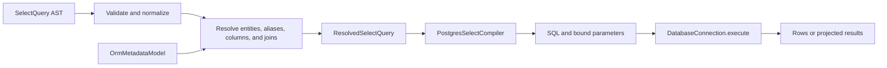

# TyORM

TyORM is a TypeScript ORM inspired by Java Persistence API (JPA). It combines decorator-based entity metadata with an explicit query API for building parameterized SQL. PostgreSQL is the current driver. Database-independent query semantics, relationship resolution, projections, and transaction orchestration live in Core.

## Packages and architecture

| Package | Responsibilities |
| --- | --- |
| [`@tyorm/core`](packages/core) | Entity and relation decorators, metadata registry and validation, query AST and builders, semantic resolution, projection APIs, transaction management, and driver contracts. |
| [`@tyorm/postgres`](packages/drivers/postgres) | PostgreSQL SQL compilation, identifier quoting and parameter placeholders, connection pooling through `pg`, and PostgreSQL transaction and error handling. |

### Metadata and relationships

Decorators record declarations on an entity class. `getEntityMetadata` reads the table, column, and primary-key declarations. `OrmMetadataModel` combines the registered entities, resolves relation ownership and join columns, and validates the resulting model. You can construct the model from an array of entity metadata or from a `MetadataRegistry` using `OrmMetadataModel.fromRegistry`.

Supported relations are `ManyToOne`, `OneToMany`, `OneToOne`, and `ManyToMany`. `JoinColumn` supplies explicit physical foreign-key mappings. `JoinTable` describes the junction table and the two sets of columns for a many-to-many relation. Composite keys can contribute multiple column pairs to a join.

### Query pipeline



1. **Build.** A `SelectQuery` describes the source entity, selected expressions, joins, filters, grouping, ordering, and pagination. Builders such as `column`, `eq`, and `param` create expression and predicate nodes.
2. **Validate and normalize.** Core checks the AST shape, aliases, clause rules, and pagination values. It then creates a frozen snapshot.
3. **Resolve.** `QuerySemanticResolver` looks up entities and properties, matches them to physical columns, and produces a direct or junction join plan from relation metadata.
4. **Compile and execute.** PostgreSQL renders SQL from the resolved query. The dialect quotes identifiers and the compilation context binds values as `$1`, `$2`, and so on. The connection executes the compiled SQL and returns the driver's rows.

The current SELECT pipeline supports aliases, `DISTINCT`, `WHERE`, direct and junction `INNER JOIN` and `LEFT JOIN`, `GROUP BY`, `HAVING`, `ORDER BY`, `LIMIT`, and `OFFSET`. Aggregate expressions include `COUNT(*)`, `COUNT(column)`, `SUM`, `AVG`, `MIN`, and `MAX`.

## Run the PostgreSQL guide

The monorepo uses pnpm. From the repository root, install dependencies and build the packages and examples:

```sh
pnpm install
pnpm build
pnpm exec tsc -p packages/core/examples/guide/tsconfig.json
pnpm exec tsc -p packages/core/examples/guide/tsconfig.legacy.json
```

Set `PGHOST`, `PGPORT`, `PGDATABASE`, `PGUSER`, and `PGPASSWORD` for a PostgreSQL database where your user can create temporary tables. Run:

```sh
node packages/core/examples/guide/run.mjs
```

If you already have the driver's local test environment file, a Node.js version with `--env-file` can load it directly:

```sh
node --env-file=packages/drivers/postgres/.env.test packages/core/examples/guide/run.mjs
```

The guide creates and seeds temporary tables, prints compiled SQL and query results, and demonstrates commit and rollback. See the [guide files and chapter index](packages/core/examples/guide/README.md).

## Usage examples

The following snippets share the same entities, resolver, compiler, and driver. They assume your PostgreSQL schema already contains `departments(department_id, name)` and `employees(employee_id, display_name, department_fk)`. The runnable guide creates its own sample schema using temporary tables.

### Define and register entities

Initialize `Symbol.metadata` before evaluating Stage 3 decorated classes. With TypeScript legacy decorators, compile with `experimentalDecorators: true` and continue declaring column types explicitly. See the [legacy example](packages/core/examples/guide/legacy.ts) and its [TypeScript configuration](packages/core/examples/guide/tsconfig.legacy.json).

```ts
import {
    Column, Entity, JoinColumn, ManyToOne, OrmMetadataModel,
    PrimaryKey, QuerySemanticResolver, ensureSymbolMetadata, getEntityMetadata
} from '@tyorm/core';

ensureSymbolMetadata();

@Entity({ name: 'departments' })
class Department {
    @PrimaryKey({ type: 'integer', name: 'department_id' })
    id!: number;

    @Column({ type: 'string' })
    name!: string;
}

@Entity({ name: 'employees' })
class Employee {
    @PrimaryKey({ type: 'integer', name: 'employee_id' })
    id!: number;

    @Column({ type: 'string', name: 'display_name' })
    name!: string;

    @ManyToOne(() => Department)
    @JoinColumn({ name: 'department_fk', referencedColumnName: 'department_id' })
    department!: Department;
}

const resolver = new QuerySemanticResolver(new OrmMetadataModel([
    getEntityMetadata(Department),
    getEntityMetadata(Employee)
]));
```

### Compile and execute a SELECT

`column('e', 'name')` uses the TypeScript property name. The resolver looks up the physical column `display_name`. The compiler binds the filter and pagination values, and the connection lease is released in `finally`.

```ts
import { column, eq, param, type SelectQuery } from '@tyorm/core';
import { PostgreSQLDriver, PostgresSelectCompiler } from '@tyorm/postgres';

const employeeId = column('e', 'id');
const employeeName = column('e', 'name');

const query: SelectQuery = {
    kind: 'select',
    from: { entity: Employee, alias: 'e' },
    selections: [
        { expression: employeeName, alias: 'employeeName' },
        { expression: column('d', 'name'), alias: 'departmentName' }
    ],
    joins: [{
        kind: 'join',
        type: 'inner',
        sourceAlias: 'e',
        relation: 'department',
        alias: 'd'
    }],
    where: eq(column('d', 'id'), param('departmentId')),
    orderBy: [{ expression: employeeId, direction: 'asc' }],
    limit: 10,
    offset: 0,
    distinct: false
};

const compiler = new PostgresSelectCompiler();
const compiled = compiler.compile(resolver.resolve(query), { departmentId: 1 });

const driver = new PostgreSQLDriver();
const password = process.env.PGPASSWORD;
await driver.connect({
    type: 'postgres',
    host: process.env.PGHOST ?? 'localhost',
    port: Number(process.env.PGPORT ?? 5432),
    database: process.env.PGDATABASE ?? 'tyorm_test',
    username: process.env.PGUSER ?? 'postgres',
    ...(password === undefined ? {} : { password })
});

try {
    const connection = await driver.acquireConnection();
    try {
        const { rows } = await connection.execute(compiled);
        console.table(rows);
    } finally {
        await connection.release();
    }
} finally {
    await driver.disconnect();
}
```

### Group and filter results

Use the existing base query and replace its selections and ordering. Here `WHERE` filters source rows by department, then `HAVING` filters the resulting groups by their employee count.

```ts
import { count, gte } from '@tyorm/core';

const departmentName = column('d', 'name');
const departmentId = column('d', 'id');
const total = count();
const groupedQuery: SelectQuery = {
    ...query,
    selections: [
        { expression: departmentName, alias: 'departmentName' },
        { expression: total, alias: 'employees' }
    ],
    groupBy: [departmentId, departmentName],
    having: gte(total, param('minimum')),
    orderBy: [{ expression: total, direction: 'desc' }]
};

const groupedSql = compiler.compile(resolver.resolve(groupedQuery), {
    departmentId: 1,
    minimum: 2
});
```

### Map rows to automatic projections, DTOs, or records

The three APIs take a query and a map of aliases to expressions. They use this map to build the SELECT list. Automatic projections infer the alias keys and expose the raw values as `unknown`. DTO projections call a mapper for each row. A record schema defines reusable field decoders and returns a frozen object per row.

```ts
import {
    defineRecord, executeDtoQuery, executeProjectionQuery, executeRecordQuery,
    type DatabaseConnection
} from '@tyorm/core';

class EmployeeDto {
    constructor(readonly name: string) {}
}

function decodeName(value: unknown): string {
    if (typeof value !== 'string') {
        throw new TypeError('Expected an employee name.');
    }
    return value;
}

const employeeRecord = defineRecord({ name: decodeName });

async function projectEmployees(connection: DatabaseConnection) {
    const select = { name: employeeName };
    const parameters = { departmentId: 1 };

    const automatic = await executeProjectionQuery(
        connection, resolver, compiler, query, select, parameters
    );

    const dtos = await executeDtoQuery(connection, resolver, compiler, query, {
        select,
        map: row => new EmployeeDto(decodeName(row.name))
    }, parameters);

    const records = await executeRecordQuery(
        connection, resolver, compiler, query, employeeRecord, select, parameters
    );

    return { automatic, dtos, records };
}
```

### Run queries in a transaction

Use a connected driver. `transaction` passes a connection lease to the callback, commits on success, and rolls back an active transaction when the callback fails. The manager releases the lease and preserves the original error. If rollback or release also fails, `TransactionError` carries the original and cleanup errors.

`withContext` tracks outstanding operations and waits for them before the transaction completes. Both forms can execute parameterized SQL or a compiled TyORM query.

```ts
import { TransactionManager } from '@tyorm/core';

async function readDepartmentTotals(connectedDriver: PostgreSQLDriver) {
    const transactions = new TransactionManager(connectedDriver);

    return transactions.withContext(async context => {
        const { rows } = await context.execute(groupedSql);
        return rows;
    }, { isolationLevel: 'READ_COMMITTED' });
}
```

## Driver extension points

- `DatabaseDriver` manages the pool lifecycle and acquires connection leases.
- `DatabaseConnection` executes parameterized SQL and exposes transaction and release operations.
- `SqlCompiler` translates a resolved query into a `CompiledQuery` with SQL and ordered parameters.
- `SqlDialect` defines identifier quoting and parameter placeholders.

A second database backend can implement these contracts while reusing the metadata model, query builders, semantic resolver, projections, and transaction manager. See the [Core contracts](packages/core/src/drivers/contracts), [compiler contracts](packages/core/src/query/compiler), and [PostgreSQL implementation](packages/drivers/postgres/src).

## Development

```sh
pnpm typecheck
pnpm --filter @tyorm/core test
pnpm --filter @tyorm/postgres exec vitest run --mode test --exclude '**/*.integration.test.ts'
```

Run `pnpm --filter @tyorm/postgres test` against a dedicated test database to include the PostgreSQL integration suites. The driver's test configuration loads environment settings for Vitest's test mode. See [AGENTS.md](AGENTS.md) for the project roadmap and development conventions.
