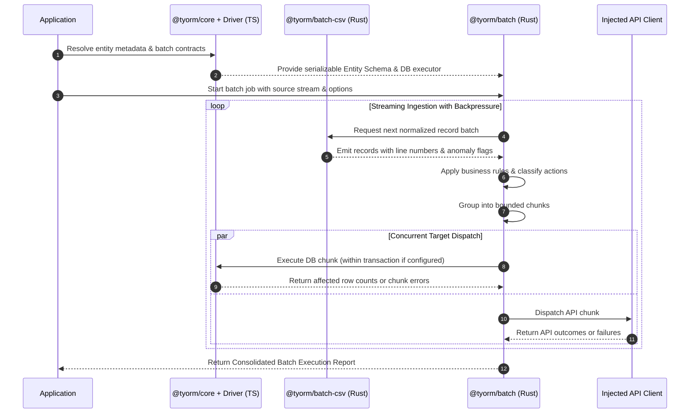

# TyORM Batch Architecture

This document describes the clean architecture, package boundaries, and execution flow for batch processing in **TyORM**. The design separates high-throughput ingestion and orchestration in **Rust** from entity metadata resolution, parameterized SQL compilation, and transaction management in **TypeScript**.

## 1. Architectural Principles

* **Core as the Single Source of Truth:** `@tyorm/core` owns entity metadata, property-to-column mapping, primary key definitions, and transaction lifecycles. Batch components never infer database schemas or bypass parameterized SQL compilation.
* **Modular & Opt-In Sources:** Following TyORM's database driver pattern, ingestion adapters are isolated under `packages/batch-sources/*` using the `@tyorm/batch-<format>` naming convention (starting with `@tyorm/batch-csv`, and extensible to `@tyorm/batch-json` or `@tyorm/batch-xml`). Applications only load the source adapters they need.
* **Defense in Depth:** Format-level validation, structural sanitization, and line-level anomaly detection happen at the ingestion boundary before business rules, chunking, or database execution take place.
* **Separation of Execution Targets:** The batch orchestrator classifies records by operational intent (`INSERT`, `UPDATE`, `UPSERT`, `API`, or `REJECT`) and routes database mutations back to `@tyorm/core` and its TypeScript drivers while dispatching external calls to an injected API client.

## 2. Monorepo Structure

```text
packages/
├── core/                         # (@tyorm/core) Entity metadata, batch contracts, SQL AST, DataSource, transactions
├── drivers/                      # TypeScript database drivers (postgres, mysql, sqlite, sqlserver)
├── batch/                        # (@tyorm/batch) Rust batch engine & TS bindings (rules, classification, chunking)
└── batch-sources/                # Pluggable ingestion adapters implemented in Rust
    ├── csv/                      # (@tyorm/batch-csv) First line of defense for streaming CSV ingestion
    ├── json/                     # (@tyorm/batch-json) Future JSON batch source
    └── xml/                      # (@tyorm/batch-xml) Future XML batch source
```

### Package Responsibilities

| Package | Runtime | Primary Responsibilities |
| :--- | :--- | :--- |
| **`@tyorm/core`** | TypeScript | Exports serializable entity schemas from `OrmMetadataModel`, defines shared batch contracts, compiles parameterized SQL per dialect, and manages connection pools and transactions. |
| **`@tyorm/drivers/*`** | TypeScript | Executes compiled single and multi-row mutations over active database connections (`PostgreSQL`, `MySQL`, `SQLite`, `SQL Server`). |
| **`@tyorm/batch-csv`** | Rust | **First line of defense.** Streams CSV input with backpressure, detects formatting/encoding errors, normalizes values, and flags suspicious characters or structural anomalies with exact line traceability. |
| **`@tyorm/batch`** | Rust | **Central orchestrator.** Evaluates business rules against the entity schema, classifies records by action, partitions work into bounded chunks, controls concurrency, and compiles the final execution report. |

## 3. Batch Pipeline Diagram

```mermaid
flowchart LR
    classDef tsNode fill:#eef2ff,stroke:#4f46e5,stroke-width:1.5px,color:#1e1b4b,rx:6,ry:6
    classDef rustNode fill:#fff7ed,stroke:#ea580c,stroke-width:1.5px,color:#431407,rx:6,ry:6
    classDef targetNode fill:#ecfdf5,stroke:#059669,stroke-width:1.5px,color:#064e3b,rx:6,ry:6
    classDef reportNode fill:#f8fafc,stroke:#475569,stroke-width:1.5px,color:#0f172a,rx:6,ry:6

    subgraph TS_CORE["@tyorm/core (TypeScript)"]
        M["OrmMetadataModel"]:::tsNode --> S["BatchEntitySchema &<br/>Batch Contracts"]:::tsNode
    end

    subgraph RUST_SOURCE["@tyorm/batch-csv (Rust)"]
        SRC["CSV File / Stream"]:::rustNode --> PARSE["Stream Parse, Normalize &<br/>Flag Anomalies"]:::rustNode
    end

    subgraph RUST_BATCH["@tyorm/batch (Rust)"]
        VAL["Validate Business Rules<br/>& Entity Schema"]:::rustNode
        CLS["Classify Actions<br/>(INSERT / UPDATE / API / REJECT)"]:::rustNode
        CHK["Partition into Chunks &<br/>Control Concurrency"]:::rustNode
        VAL --> CLS --> CHK
    end

    subgraph EXEC_TARGETS["Execution & Persistence"]
        CORE_EXEC["@tyorm/core + TS Drivers<br/>(Parameterized SQL & Tx)"]:::tsNode
        DB[("Database<br/>PG / MySQL / SQLite / MSSQL")]:::targetNode
        API_CLIENT["Injected API Client"]:::targetNode
        EXT_API["External Service / API"]:::targetNode
        CORE_EXEC --> DB
        API_CLIENT --> EXT_API
    end

    REP["Consolidated<br/>BatchExecutionReport"]:::reportNode

    S --> VAL
    PARSE -->|"RawBatchRecord + Line Info"| VAL
    CHK -->|"DB Chunks"| CORE_EXEC
    CHK -->|"API Chunks"| API_CLIENT
    CLS -.->|"Rejected Rows"| REP
    DB -.->|"Affected Rows & Errors"| REP
    EXT_API -.->|"API Outcomes & Errors"| REP
```



## 4. Execution Lifecycle & Data Flow

The pipeline follows a strict, five-stage lifecycle starting from `@tyorm/core`:



### Stage Breakdown

1. **Contract & Metadata Extraction (`@tyorm/core`):**
   Before ingestion begins, `@tyorm/core` extracts a lightweight, serializable schema from `OrmMetadataModel` containing physical column names, property mappings, data types, nullability, and primary key definitions.
2. **First-Line Defense (`@tyorm/batch-csv`):**
   The Rust CSV adapter reads the input stream incrementally. It catches malformed rows, column count mismatches, invalid character encodings, and control or suspicious character patterns. Instead of crashing on corrupt rows, it attaches structured anomaly metadata and exact source line numbers to each record.
3. **Validation, Classification & Chunking (`@tyorm/batch`):**
   The Rust batch engine validates incoming records against business rules and the entity schema. Valid records are classified into operational buckets (`INSERT`, `UPDATE`, `UPSERT`, or `API`), while invalid records are routed to `REJECT`. Items are grouped into size-bounded chunks calibrated to database parameter limits and concurrency settings.
4. **Target Execution (`@tyorm/core` + Drivers & Injected API Client):**
   * **Database Path:** Clean chunks return to TypeScript, where `@tyorm/core` and the selected driver compile parameterized SQL statements and execute them—optionally wrapped in a single managed transaction (`DataSource.transaction`) for atomic rollback guarantees.
   * **External API Path:** Chunks marked for external synchronization are dispatched through the caller-supplied API client under the same concurrency and error-handling policy (`FAIL_FAST` or `CONTINUE_ON_ERROR`).
5. **Consolidated Reporting:**
   Once all streams and chunks settle, `@tyorm/batch` aggregates metrics (total read, inserted, updated, API-dispatched, rejected, and failed counts) alongside per-item failure diagnostics with source line traceability.