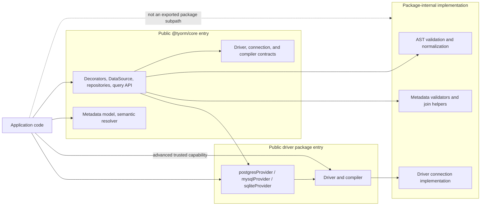

# `@tyorm/core`

Core contains TyORM's database-independent API and coordination layer: decorators and metadata, query AST/builders, semantic resolution, repositories, projections, DataSource, and transaction orchestration.

For application setup and API examples, start with the [root README](../../README.md). The runnable [PostgreSQL guide](examples/guide/README.md) demonstrates entities, relationships, queries, projections, and transactions.

## Architecture

The application uses public Core APIs. Core validates and resolves query meaning, while the selected driver compiles SQL and owns its engine-specific connection behavior.



The dashed edge represents a package import restriction, not a sandbox. The application can use the documented package entry points; package `exports` maps reject direct imports of internal subpaths. Core exposes `@tyorm/core` and the side-effect entry `@tyorm/core/register`.

## Public API and encapsulation

The public root exports the contracts and features required by normal applications and supported extensions:

- Entity and relation decorators, column and key options, metadata types, `MetadataRegistry`, and `OrmMetadataModel`.
- Query AST types and builders, `QuerySemanticResolver`, projections, DTOs, records, and resolved-query/compiler contracts for advanced query integrations.
- `DataSource`, repositories, custom-repository support, and transaction APIs.
- Driver contracts such as `DatabaseDriver`, `DatabaseConnection`, and `SqlCompiler`.

The root does not export implementation helpers such as `ManagedTransactionContext`, relation/join resolvers, metadata validators, the AST normalizer/validator, `resolveMutation`, or `getRelationDeclarations`. `ensureSymbolMetadata` is also internal; import `@tyorm/core/register` before evaluating Stage 3 decorated classes when the runtime needs `Symbol.metadata` initialized.

TypeScript's `private` and `protected` modifiers primarily constrain type-checked source. They are not authorization boundaries against code already running in the same process. Package export maps make normal deep imports unavailable, but they do not isolate trusted application code from each other.

`DatabaseConnection` and `TransactionManager.transaction` are intentional low-level APIs. A connection can execute caller-supplied SQL and does not apply the entity/AST validation performed by `DataSource`. Keep connection and driver handles within trusted application code; prefer `DataSource` and repositories for ordinary application operations.

For future driver export or encapsulation changes, follow the [`driver-api-boundaries` skill](../../.github/skills/driver-api-boundaries/SKILL.md).

## Extension model

`DataSource` accepts a provider factory for the configured engine. A provider returns a compatible driver and compiler. A custom driver can implement the Core contracts without changing Core's query semantics; a compiler handles dialect-specific SQL and placeholders.

Use the driver package's provider for normal applications. Directly constructing drivers, compilers, or connection leases is an advanced integration path. Driver-specific setup and tests are documented in the [PostgreSQL](../drivers/postgres/README.md), [MySQL](../drivers/mysql/README.md), and [SQLite](../drivers/sqlite/README.md) package guides.

## Development

Run from the monorepo root:

```powershell
pnpm --filter @tyorm/core typecheck
pnpm --filter @tyorm/core test
pnpm --filter @tyorm/core build
```

The Core test suite uses in-memory fixtures. For the integration-test safety gates and workspace-wide checks, see the [root README development section](../../README.md#development) and [`AGENTS.md`](../../AGENTS.md).
